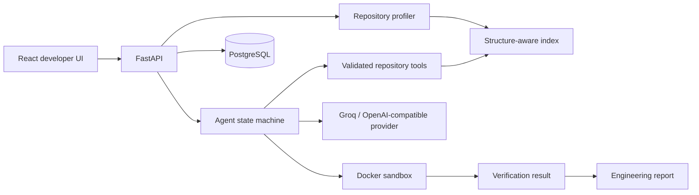

# RepoWise

RepoWise is an evidence-first AI software engineering platform. It imports a local or public GitHub repository, creates a structure-aware code index, combines deterministic findings with an explicit debugging state machine, proposes regression tests, executes allowlisted test commands in restricted Docker containers, and keeps observed facts separate from hypotheses and verification.

## What works

- Local-path and public GitHub ingestion with URL, path, size, file-size, secret, and generated-file guards
- Python, JavaScript, and TypeScript profiling; additional language detection for Java, Go, and C++
- Python AST chunks and symbol-aware JS/TS chunks with file, language, symbol, type, imports, and line metadata
- Replaceable retrieval layer with semantic-like sparse vectors plus symbol/path ranking and filters
- Deterministic Python/JS checks and an auditable `understand → retrieve → investigate → generate_test → report` workflow
- OpenAI-compatible and Groq provider abstraction with schema validation and one constrained retry
- Docker test runner with no network, CPU/memory/PID/time limits, a read-only repository mount, and allowlisted commands
- PostgreSQL persistence, SQLAlchemy models, Alembic migration, structured request logging, OpenAPI, and a responsive React UI
- A deliberately buggy sample repository and repeatable evaluation script

## Architecture



The LLM is optional: profiling, retrieval, deterministic analysis, and the sample investigation run without a paid key. RepoWise never labels a proposed fix as verified unless execution evidence exists.

## Quick start with Docker

Requirements: Docker Desktop with Compose v2.

```bash
cp .env.example .env
docker compose up --build
```

Open `http://localhost:5173`; API docs are at `http://localhost:8000/docs`. In the UI choose **Add repository**, keep **Local path**, use `/workspace/examples/sample-python-project`, and import. Then run Analysis or open Debug Lab with the prefilled login report.

The Compose stack builds dedicated unprivileged Python and Node sandbox images before starting the API. Repository commands are never run directly on the backend host.

## Local development

Backend (SQLite is the default when no `.env` overrides it):

```bash
cd backend
python -m venv .venv
# Windows: .venv\Scripts\activate
# macOS/Linux: source .venv/bin/activate
pip install -e ".[dev]"
uvicorn app.main:app --reload
```

Frontend:

```bash
cd frontend
npm install
npm run dev
```

Use the host's absolute sample path for local-backend ingestion. Test execution still requires Docker.

The backend allows frontend origins `http://localhost:5173` and `http://localhost:5174` by default, including when Vite moves to port 5174 because 5173 is busy. For another frontend address, add its exact origin to the comma-separated `CORS_ORIGINS` setting and restart the backend. For Docker, run `docker compose up -d --force-recreate backend` to apply the setting.

## Configuration

Copy `.env.example`; never commit `.env`. Important values are `DATABASE_URL`, `LLM_PROVIDER` (`disabled`, `groq`, or `openai`), provider key/model settings, `SANDBOX_TIMEOUT`, `MAX_REPOSITORY_SIZE_MB`, and `MAX_FILE_SIZE_KB`. `LLM_PROVIDER=disabled` is the safe default.

## API

| Method | Endpoint | Purpose |
|---|---|---|
| `POST` | `/api/repositories` | Import exactly one local path or public GitHub URL |
| `POST` | `/api/repositories/{id}/scan` | Profile and index repository |
| `GET` | `/api/repositories/{id}/structure` | Return bounded file metadata |
| `POST` | `/api/search` | Retrieve code with language/path filters |
| `POST` | `/api/analysis` | Run deterministic code analysis |
| `POST` | `/api/debug` | Execute the investigation graph |
| `POST` | `/api/tests/generate` | Create a separate test proposal record |
| `POST` | `/api/tests/run` | Run an allowlisted runner in Docker |
| `GET` | `/api/reports/{run_id}` | Return facts, hypotheses, and verification separately |

Full request/response schemas are available in OpenAPI. See [API notes](docs/api.md).

## Agent and RAG design

The state machine passes a typed investigation state between focused nodes. Retrieval ranks bounded syntax-aware chunks; agents receive relevant symbols rather than an entire repository. Tool access is registered and validated—there is no general shell tool. Prompt roles live under `backend/prompts/`, separate from implementation.

See [agents](docs/agents.md), [RAG](docs/rag.md), and [architecture](docs/architecture.md).

## Database

The MVP persists repositories, analysis/debug/test-generation runs, generated-test records, and test executions. The initial Alembic migration is under `backend/migrations`. The model is intentionally ready to grow into user, issue, and report-specific tables without coupling analysis services to SQLAlchemy.

## Security model

Repository URLs are restricted to public HTTPS GitHub URLs, local paths are resolved, traversal is blocked in tools, known secrets/artifacts are excluded, input and LLM outputs are validated, credentials stay in environment variables, and test processes run without network access under resource limits. Mounting the Docker socket is powerful; production should replace it with a dedicated isolated runner service. See [security](docs/security.md).

## Tests and evaluation

```bash
cd backend && python -m pytest -q
cd ../frontend && npm run build
python scripts/evaluate.py
```

The sample benchmark measures detection, root-cause localization, proposed-test generation, verification rate, and runtime. Verification is expected to remain `unable_to_verify` until a reviewed fix is applied and executed; that is a safety property, not a fabricated success. See [evaluation](docs/evaluation.md).

## Limitations and next steps

The current index is in-process and uses sparse local vectors; the `CodeIndex` boundary is intended for a persistent Chroma/FAISS adapter. Java/Go/C++ are profiled but do not yet have AST chunkers. The MVP proposes patches/tests without automatically mutating imported repositories. Production work should add a queue, isolated runner hosts, auth/RBAC, durable vector storage, WebSocket progress, richer Ruff/Bandit/ESLint adapters, coverage parsing, and explicit human approval before patch application.

